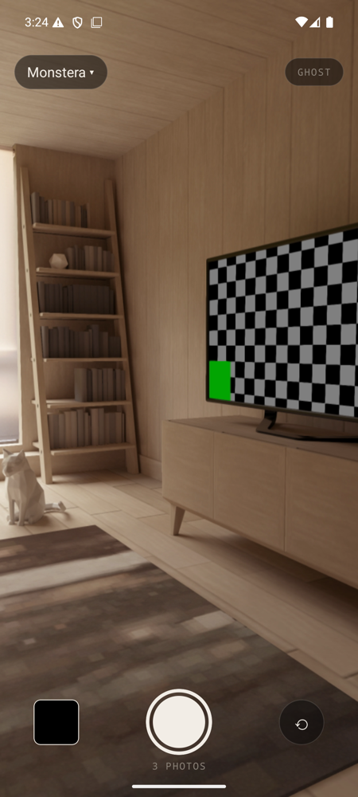
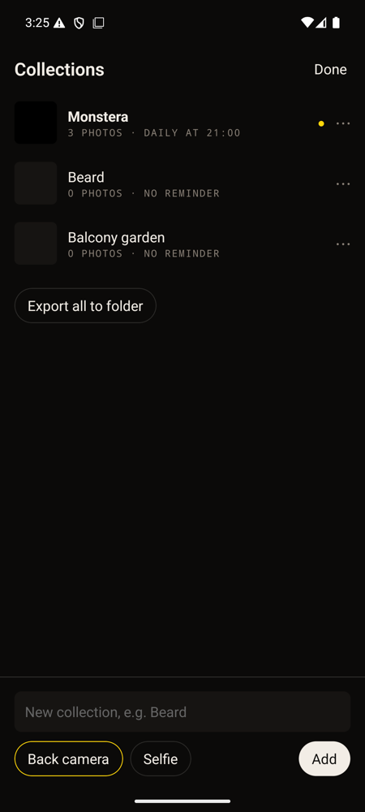

# Progress Camera

A camera for progress photos, where the camera is the album. Pick a tracker ("Monstera", "Beard"), shoot, and the photo is already filed with its date. Then watch the change over time: timeline, side-by-side compare, flipbook.

Minimal UI, inspired by [Tinycam](https://tiny.cam/) by Shyjal: opens straight to the viewfinder, one shutter, warm near-black with one yellow accent, and nothing leaves the phone. Photos are kept at full quality.

<p>
  
  
  
</p>

## Features
- **Collections**: one per thing you track; each remembers front/back camera.
- **Ghost overlay** (off by default, tap GHOST): the last photo sits at 30% opacity over the live viewfinder so shots line up.
- **Full quality**: photos are saved exactly as the camera takes them, in the app's private storage (not the camera roll).
- **Timeline** with a "Day N" count, **Compare** (Day 1 vs any day), **Flipbook**.
- **Reminders** per collection: daily or weekly (pick the day), any time. Tapping one opens that collection's camera.
- **Volume-key shutter** (Android).
- **Gallery backup**: every photo is also saved to `Pictures/Progress Camera` (turn on Google Photos backup for that folder). If the app is reinstalled or its data is wiped, it rebuilds itself from that album. Deleting in the app keeps the gallery copy.
- **Export to folder**: full-quality copies, one subfolder per collection, plus `notes.txt`; re-running only copies new photos.
- Notes per photo; Android back button walks back through screens.

## Code
- `App.tsx`: small state router (camera, collections, timeline, settings) + Android back handling
- `src/store.ts`: AsyncStorage state + photo files under `Paths.document/photos`
- `src/CameraScreen.tsx`, `src/CollectionsScreen.tsx`, `src/TimelineScreen.tsx`, `src/SettingsScreen.tsx`
- `src/reminders.ts` (expo-notifications), `src/backup.ts` (export via Storage Access Framework)
- `plugins/`: volume-key shutter and release signing config plugins

## Next
Swipe up to the timeline, grid overlay, timelapse video export, home-screen widget.

## Install
Download the latest APK from [Releases](../../releases/latest) and open it on your Android phone (allow installs from your browser or file manager). Or add this repo to [Obtainium](https://github.com/ImranR98/Obtainium) to get updates automatically.

## Release
Bump `version` and `android.versionCode` in `app.json`, then:
```bash
git tag v1.0.1 && git push origin v1.0.1
```
GitHub Actions builds a signed arm64 APK and publishes the release. Signing secrets: `ANDROID_KEYSTORE_BASE64`, `ANDROID_KEYSTORE_PASSWORD`, `ANDROID_KEY_ALIAS`, `ANDROID_KEY_PASSWORD`.

## Local build
```bash
./scripts/build-apk.sh                        # signed, if ../progress-camera-keys exists
adb install -r progress-camera.apk
```
Photos live in the app's private storage (`/data/user/0/com.aldrinjenson.progresscamera/files/photos/`); use Export to copy them out.

## License
MIT
