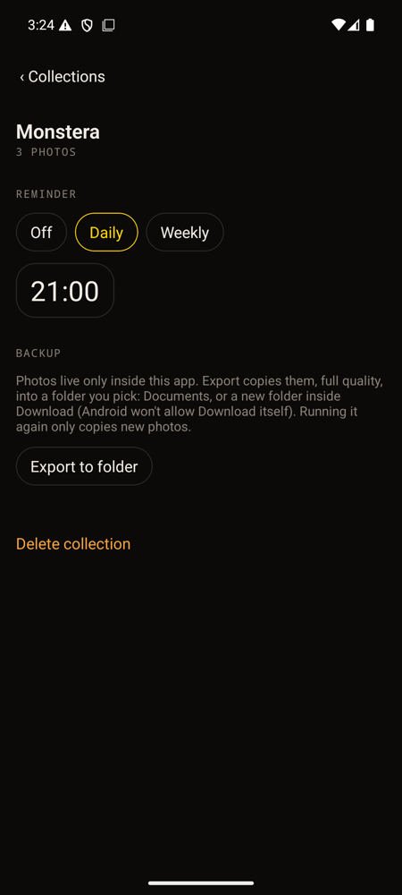

# Progress Camera

A camera for progress photos, where the camera is the album. Pick a tracker ("Monstera", "Beard"), shoot, and the photo is already filed with its date. Then watch the change over time: timeline, side-by-side compare, flipbook.

Minimal UI, inspired by [Tinycam](https://tiny.cam/) by Shyjal: opens straight to the viewfinder, one shutter, warm near-black with one yellow accent, and nothing leaves the phone. Photos are kept at full quality.

<p>
  
  
  
</p>

## Features
- **Collections**: one per thing you track; each remembers front/back camera.
- **Ghost overlay** (off by default, tap GHOST): the last photo sits at 30% opacity over the live viewfinder so shots line up.
- **Full quality**: photos are saved exactly as the camera takes them, in the app's private storage (not the camera roll).
- **Timeline** with a "Day N" count, **Compare** (Day 1 vs any day), **Flipbook**.
- **Reminders** per collection: daily or weekly (pick the day), any time. Tapping one opens that collection's camera.
- **Volume-key shutter** (Android).
- **Export to folder**: full-quality copies, one subfolder per collection, plus `notes.txt`; re-running only copies new photos.
- Notes per photo; Android back button walks back through screens.

## Run
```bash
npm install
```
The volume shutter is a native config plugin (`plugins/withVolumeShutter.js`), so Expo Go can't run the full app; build the APK below.

## Code
- `App.tsx`: three-screen state router
- `src/store.ts`: AsyncStorage state + photo files under `Paths.document/photos`
- `src/CameraScreen.tsx`, `src/CollectionsScreen.tsx`, `src/TimelineScreen.tsx`

## Next
Swipe up to the timeline, grid overlay, timelapse video export, home-screen widget.

## Build an APK (local, no EAS)
```bash
npx expo prebuild --platform android --clean
cd android && ANDROID_HOME=/opt/homebrew/share/android-commandlinetools ./gradlew assembleRelease
adb install -r app/build/outputs/apk/release/app-release.apk
```
Release is signed with the debug key (fine for sideloading). Photos live in `/data/user/0/com.aldrinjenson.progresscamera/files/photos/`.
